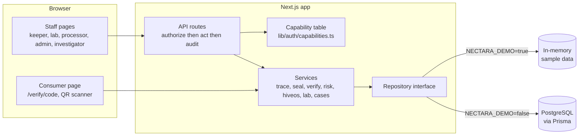
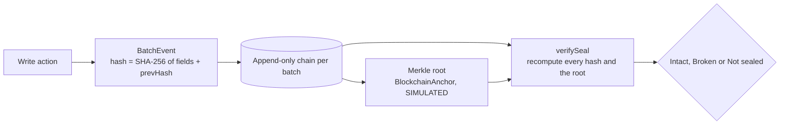

# Nectara

**Proof in every jar. Verified honey, from hive to shelf.**

Nectara is a honey traceability and smart-beekeeping platform built for the Orbix Hackathon 2026.

- **HIVEOS** keeps a digital twin of each hive, classifies its health (stable, watch, stressed, critical) and explains why.
- **TRACE** records every hand-off from hive to shelf exactly once, in an append-only log where each event carries the hash of the one before it.
- **VERIFY** puts an HMAC-signed QR code on each jar. A buyer scans it and sees origin, journey, lab status and record integrity. No account needed.

## The integrity principle

Two claims, never merged, in the code and in the UI:

| Claim | Answers | Evidence |
|---|---|---|
| **Lab evidence** | "Is the honey genuine?" | A lab certificate bound to one specific batch. Only the lab role can publish it. |
| **Record seal** | "Has the record been rewritten?" | SHA-256 event hashes rolled into a Merkle root. |

Nothing here says "blockchain proves purity". The ledger is **simulated**: roots are stored in the database and labelled "Simulated ledger". Nothing is written to a public chain.

A risk score orders the investigation queue. A high score is not a verdict of fraud; a person reviews every case.

## Quick start (demo mode, no database, no internet)

```powershell
npm install        # also runs `prisma generate`
npm run dev
```

Open <http://localhost:3000>. Demo mode is on unless `NECTARA_DEMO=false`. It runs the whole app from in-memory sample data, and every screen shows a **Sample data** chip.

Demo accounts (password `demo1234`, shown on the login page in demo mode):

| Role | Email |
|---|---|
| Honey keeper | ravi@demo.nectara |
| Collector | collector@demo.nectara |
| Quality lab | lab@demo.nectara |
| Processor | processor@demo.nectara |
| Distributor | distributor@demo.nectara |
| Investigator | investigator@demo.nectara |
| Admin | admin@demo.nectara |

Fonts are self-hosted, so the app also works offline.

## Database mode (PostgreSQL)

```powershell
copy .env.example .env      # then set AUTH_SECRET and QR_SECRET to two different random values
# set NECTARA_DEMO=false and DATABASE_URL in .env
docker compose up -d db     # or point DATABASE_URL at any Postgres
npx prisma migrate deploy
npm run db:seed             # loads the same sample story into Postgres
npm run build; npm start
```

`docker compose up` also builds the app container; it needs `AUTH_SECRET` and `QR_SECRET` in the environment.

> **Honest status:** the database path (Prisma repository, migration, seed) is written and type-checked, and the demo repository returns exactly the same types. It has **not** been run against a live Postgres in the environment this was built in. Run the steps above once before relying on it.

## Environment

| Variable | Purpose |
|---|---|
| `NECTARA_DEMO` | `true` (default) runs from memory. `false` uses Postgres. |
| `AUTH_SECRET` | Signs session cookies. **Required in production.** |
| `QR_SECRET` | Signs QR labels. **Required in production, and must differ from `AUTH_SECRET`.** |
| `DATABASE_URL` | Postgres connection string (database mode only). |
| `GEMINI_API_KEY` | Optional. Turns on AI answers and semantic search. Free key at aistudio.google.com/apikey. |
| `GROQ_API_KEY` | Optional. AI answers via Groq, used as the fallback (or first, with `AI_PROVIDER=groq`). Free key at console.groq.com/keys. |
| `GEMINI_MODEL`, `GROQ_MODEL`, `GEMINI_EMBED_MODEL` | Optional model overrides. Defaults: `gemini-3.1-flash-lite`, `openai/gpt-oss-120b` (low reasoning), `gemini-embedding-001`. |
| `RATE_LIMIT_MULTIPLIER` | Optional. Multiplies every rate limit, for load tests (the e2e suite uses 100). Values below 1 are ignored, so limits can be raised but never removed. |

Generate secrets with `openssl rand -hex 32`. A production build without them refuses to start, on purpose.

## Rate limits

Every limit is a sliding window in `lib/rate-limit.ts`. A refused request gets a `429` with a `Retry-After` header and a plain message ("Too many sign-in attempts. Try again in 40 seconds.").

| What | Limit | Keyed by | Where |
|---|---|---|---|
| Sign-in attempts | 10 a minute | IP address | `/api/auth/login` |
| Failed sign-ins | 5 per 15 minutes, cleared on success | account and IP together, so an attacker elsewhere cannot lock out a real user | `/api/auth/login` |
| Any API call | 120 a minute | user | `authorize()`, so every route |
| Writes to the record | 30 a minute | user | `writeRoute()`, so every write route |
| AI answers and summaries | 8 a minute | user | `/api/ai/ask`, `/api/ai/explain` |
| Public label checks | 30 a minute | IP address | `/verify/[code]`, before a scan is recorded |

Two caveats:

- Counters live in memory per server process. They reset on restart and are not shared across instances. Move the store to Redis or Postgres before running more than one instance.
- Per-IP limits read `x-forwarded-for`, so run behind a proxy that sets it (Vercel and nginx do). Without one, every visitor counts as the same "unknown" address and shares a single sign-in and verify allowance, and a directly exposed server can be sent a spoofed header.

## Scripts

| Command | What it does |
|---|---|
| `npm run dev` | Development server |
| `npm run build` / `npm start` | Production build and server |
| `npm run lint` / `npm run typecheck` | ESLint and `tsc --noEmit` |
| `npm test` | Unit and route tests (Vitest) |
| `npm run test:e2e` | Builds, then runs the Playwright end-to-end flows (uses installed Chrome) |
| `npm run stats` | Prints real counts of models, API routes and tests |
| `npm run db:seed` | Seeds Postgres with the sample story |

On CI without Chrome: `npx playwright install chromium`, then set `PW_CHANNEL=` (empty) before `npm run test:e2e`.

## Architecture



The integrity pipeline:



Key design points:

- **One access table.** Every API route calls `authorize(action)`, which checks `lib/auth/capabilities.ts`. Hiding a button is never the control.
- **Events are append-only.** The repository has no update or delete for events, the database has a unique constraint on `(batchId, prevHash)`, and a test fails if any API route exports `PUT`, `PATCH` or `DELETE`.
- **One repository interface, two implementations.** Both return the Prisma model types, so demo and database mode cannot drift apart without failing the type check.
- **Risk engine.** Five weighted groups (lab 40, traceability 20, supplier 15, geo and timeline 15, process 10), every point with a reason, rule-set version stored on each score. Alerts within 72 hours that share a farm, organisation, lab or batch lineage are grouped into incidents.

## Roles

| Role | Can do |
|---|---|
| Honey keeper | Hives, inspections, harvests, batches, HIVEOS |
| Collector | Collection and custody hand-offs |
| Quality lab | Publish lab results. **Only this role can.** |
| Processor | Processing, blending, packaging, QR labels |
| Distributor | Custody and shipments |
| Investigator | Risk and incident centre, cases |
| Admin | Users, role matrix, audit log |

Consumers need no account.

## Guided tour (for judges)

Open **`/tour`** (linked from the landing hero, the landing nav and the login page) and press *Start the tour*. It has 10 stops and takes about 8 minutes. Each stop signs you in as the right demo role and opens the right page. A honey-coloured strip under the header shows "Do this" and "Notice" for that page, with Back, Next, All stops and Exit. The Back and Next row stays in view while you scroll.

- The stops live in `lib/tour.ts`, and `tests/tour.test.ts` checks that every page, role and sample code a stop names really exists.
- Switching roles goes through `POST /tour/[n]`: demo mode only, never triggered by link prefetching, and rate-limited like sign-in.
- The tour shows nowhere outside demo mode.

## Demo script, by hand (about 7 minutes)

1. **Landing** (`/`). Read the two-claims section: lab evidence versus record seal. Click *Try the demo*.
2. **Keeper** (`ravi@demo.nectara`). Dashboard: hive health ring, harvest by month, needs attention. Open hive **A-106** (Watch): read *Why this state*, the trust ladder, then move the *What if* sliders (+3 °C for 5 days).
3. **Record a harvest** from Batches, then *Record harvest*. You land on the new batch with its hash-chained events.
4. **Quality lab** (`lab@demo.nectara`). Open Lab, pick the new batch, publish a passing result with a certificate. Try the same certificate on another batch and watch it be refused and flagged.
5. **Processor** (`processor@demo.nectara`). Open the batch, *Take custody*, then *Issue QR label*. The QR code and link appear.
6. **Consumer.** Open the link in a private window, ideally on a phone. Lab evidence and Record seal are two separate cards.
7. **Verify page samples** (`/verify`). Open the four sample links: valid, revoked, copied (scanned in two cities), tampered signature.
8. **Broken seal.** As keeper, open batch **HC-2026-00118**: *Broken: record changed after sealing*, naming the first mismatching event. Compare with **HC-2026-00124** (Intact).
9. **Investigator** (`investigator@demo.nectara`). Risk: run the engine, expand *Why this score*, open the incident around Himalayan Honey Lab, open a case and add a note.
10. **Admin** (`admin@demo.nectara`). The role matrix and audit log show everything that was just done.

## AI assistant (optional)

Two features, both off until a free Gemini or Groq key is set:

- **Ask Nectara** (the Ask button in the app's top bar): answers questions from the records the signed-in role may open, cites each record by number and links to it. Answers in English, Bengali or Hindi.
- **Plain-language summaries:** "In plain words" on a hive page for keepers, and "Case brief" on an incident page for investigators. They are written only from the rule engine's output shown on the same page.

How it works (`lib/ai`):

1. **Corpus** (`corpus.ts`): every batch, hive, incident and product guide is turned into a short text record. The corpus is built per request from the role's own permissions: a lab never retrieves hive data, and only investigators retrieve incidents and risk scores.
2. **Retrieval** (`rag.ts`): BM25 keyword ranking, plus Gemini embeddings when `GEMINI_API_KEY` is set, merged with reciprocal rank fusion. A record code in the question (`HC-2026-00124`, `A-105`) always ranks first. Embeddings are cached by content hash, so a record is embedded once until it changes.
3. **Generation** (`providers.ts`): one OpenAI-compatible `fetch` client for Gemini and Groq, with no SDK dependency. Gemini answers first and Groq takes over on a rate limit, error or timeout. The prompt allows answers only from the numbered sources, tells the model to treat them as data rather than instructions, and repeats the integrity rules: a seal never proves purity, and a risk score is not a verdict.
4. **Limits:** 8 AI requests a minute per user (see Rate limits), a 500-character question cap, a 25 s timeout, and an audit row for every answer.

Without a key, Ask Nectara still returns the matching records, found by keywords, and the summary cards say AI is not set up. **Privacy:** with a key set, the retrieved records (batch, hive and incident text, with organisation names but no emails or personal user names) are sent to Google or Groq. Check their data terms before using real data.

## API

17 route handlers under `app/api`: auth (`login`, `logout`), `harvests`, `batches` (list, detail, step, blend), `anchor`, `lab`, `qr` (issue, revoke), `hives/[code]/[kind]` (readings, inspections), `risk` (live scores, run), `incidents/[id]/case`, `cases/[id]`, `admin/users`. Run `npm run stats` for current counts.

## Deploy to Vercel (demo mode)

Demo mode needs no database. In the Vercel project set:

```
NECTARA_DEMO=true
AUTH_SECRET=<random>
QR_SECRET=<a different random value>
```

The build runs `prisma generate` through `postinstall`, so no database is needed at build time. Without both secrets the production build returns errors on purpose.

**Know the limit:** in demo mode, writes live in each server instance's memory. On serverless hosting, different requests can hit different instances and instances restart, so recorded harvests, results and cases can disappear or appear inconsistent. Reading flows and the seeded story work fine. For a demo where you record things live, run it locally or on a single long-lived server, or use database mode.

## Known limits

- The ledger is simulated. `POLYGON_AMOY` exists as a network value but nothing writes to it.
- Impossible-travel risk checks are not evaluated yet because custody has no location data. The risk screen says so.
- Clone detection compares city names inside a 6-hour window rather than distances. City comes from the Vercel `x-vercel-ip-city` header, so it is empty locally.
- Hive health thresholds, the flowering-season table and lab limits are rule-of-thumb data, kept in `lib/hiveos.ts` and `lib/risk.ts`. Have a domain expert review them before real use.
- Lab certificates are recorded by reference and values; file upload is not built.
- The AI assistant is optional and the app is fully functional without it. Bengali and Hindi text uses the device's system fonts, because the bundled Inter covers Latin only.
